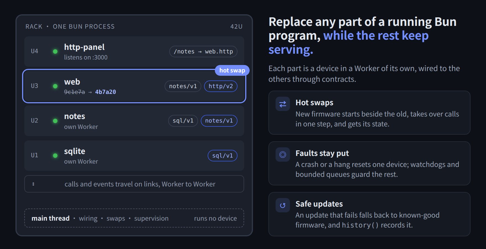

<!-- docs/images/rack.html da8810b0ded6 -->

# rack42u

**Replace any part of a running Bun program while the rest keep serving.** You build the program from **devices**, one file each, and mount them in a **rack**, one process, where any device can be swapped, reloaded, restarted, plugged in, or unplugged on its own.

[Hot reload in a minute](#hot-reload-in-a-minute) · [Quick start](#quick-start) · [Concepts](docs/concepts.md) · [Documentation](docs/README.md)

## Why

| In one Bun process | In a rack |
|---|---|
| Importing a module again reloads that file only, and its imports keep their old code. | Each device runs in a Worker of its own, so a new version loads as fresh code. |
| One uncaught exception ends the process, with all its parts. | A crash or a hang resets one device, and the others keep serving. |
| Nothing bounds the work: calls pile up, and a hang goes unnoticed. | Every queue and wait has a bound, and watchdogs catch devices that hang. |

## Hot reload in a minute

In a clone of this repository, after `bun install`, save two files:

```ts
// hello/devices/hello.ts
import { device } from "rack42u";
import { Http, httpHandler } from "rack42u/std";

export default device({
  model: "hello",
  provides: { http: Http },
  powerOn: () => ({ http: httpHandler(() => new Response("Hello\n")) }),
});
```

```ts
// hello/rack.ts
import { rack, slot } from "rack42u";
import { httpPanel } from "rack42u/std";

export default rack("hello", {
  slots: {
    1: slot("./devices/hello.ts"),
    2: httpPanel({ port: Number(process.env.PORT ?? 3000), routes: { "/*": "hello.http" } }),
  },
});
```

Start the rack with hot reload, and ask it:

```sh
bun src/cli.ts dev hello/rack.ts
curl localhost:3000     # Hello
```

Change `"Hello\n"` to `"Hello again\n"` in `hello/devices/hello.ts`, and save:

```sh
curl localhost:3000     # Hello again
```

- **Same process, same port:** the rack built the new firmware, started it beside the old one, and moved the calls over. Its log says `hello swapped`.
- **In an app of your own**, the command is `rack dev`, as [Getting started](docs/getting-started.md#change-a-device-while-it-runs) shows.

## How it works

- **[Devices](docs/concepts.md#devices)** run in Workers of their own, so a crash, a leak, or a blocked event loop stays in its device.
- **[Connectors](docs/concepts.md#connectors-and-ports)** are the contracts between devices, such as `notes/v1`, with a schema for everything that crosses. No device imports another.
- **[Swaps](docs/concepts.md#swaps)** start a new version beside the old one, which hands over its calls in one step, and its state. A new version that fails leaves the old firmware in its slot.
- **[Supervision](docs/concepts.md#faults)** resets devices that crash, catches those that hang, bounds every backlog, and falls back from updates that fail. `status()`, `metrics()`, `history()`, and the log report it all.

## Why it is built this way

Four goals, in this order when they conflict: **reliability**, **maintainability**, **observability**, and **extensibility**.

| Choice | Because |
|---|---|
| One Worker per device | Only a fresh Worker gives a device fresh code, and only ending one frees everything it opened. |
| The backplane as the only channel between devices | Any device can be replaced alone. |
| Links from Worker to Worker | Calls don't wait for the main thread, which stays free to supervise. |
| A content hash as each device's version | A rebuild replaces only what changed, and an update has known-good firmware to fall back to. |
| A bound on every wait and queue | Overload and hangs fail fast, with codes, instead of piling up. |

[Design](docs/design.md) gives the reasons in full, what each choice costs, and the limits that remain.

## Quick start

[`examples/shop-api`](examples/shop-api) stacks a SQLite database, a cache, an orders API, and the HTTP panel, which passes `/api/*` to the orders API.

```sh
bun install
bun src/cli.ts start examples/shop-api/rack.ts   # PORT=4000 to change the port
```

```sh
curl -X POST localhost:3000/api/orders \
  -H 'content-type: application/json' \
  -d '{"item":"book","quantity":2,"price":12.5}'
# {"id":1,"item":"book","quantity":2,"price":12.5}

curl localhost:3000/api/orders/1     # served from the cache: "cached":true
curl localhost:3000/api/orders       # {"currency":"USD","orders":[...]}
curl localhost:3000/api/stats        # {"served":4,"firmware":"..."}
```

- **Stop:** Ctrl-C powers the devices off from the top down.
- **Hot reload:** start with `dev` instead of `start`, and edit `examples/shop-api/devices/orders.ts`. Only `orders` is swapped, and `/api/stats` keeps counting, under a new firmware hash.
- **A desktop app:** [`examples/net-tool`](examples/net-tool), a TCP and UDP tool on Tauri 2, whose installers run its rack as one executable.
- **An app of your own:** [Getting started](docs/getting-started.md) adds rack42u through git, writes two devices and a rack, runs and tests them, and changes one while the rack runs.

## Status

What works, on Linux, macOS, and Windows:

- devices that call each other, emit events, and stream bytes, with schemas on every port;
- hot swaps, cold swaps, restarts, reloads, fallback from updates that fail, rollback, and a history of updates;
- racks placed by hand, and racks scanned from directories of device files, with a plan file to review;
- crash resets, watchdogs, bounded backlogs, and threads stuck in native code;
- listeners that devices open, and the HTTP panel, with WebSocket, files sent from disk, and certificates that change without a restart;
- the standard `memkv` and `sqlite` devices, the `rack` command, a test bench, injected faults, counters, and logs for other programs;
- a rack in one executable, from `rack compile`, whose devices files beside it replace, at a reload or, with `--watch`, as they change.

There is no formal release yet: any version until the first one may break the API. Apps depend on rack42u through git, at a tag or a commit, as [Getting started](docs/getting-started.md#add-rack42u) shows.

### Not supported yet

- Devices in child processes. No device ever runs on the rack's main thread.
- A management dashboard.
- Racks connected to each other.

## Documentation

| Read | For |
|---|---|
| [Getting started](docs/getting-started.md) | An app of your own, from adding rack42u to changing a device while the rack runs |
| [Concepts](docs/concepts.md) and [Design](docs/design.md) | How a rack works, and why it is built this way |
| [The guides](docs/README.md#guides) | Each part, from connectors and devices to updates, faults, and the HTTP panel; the tests run the app they build |
| [The reference](docs/README.md#reference) | The API, the `rack` command, the error codes, the reports, and the limits |
| [Working with an agent](docs/getting-started.md#working-with-an-agent) | A skill for coding agents, which reads the documentation of the version an app installed |

## Requirements

- [Bun](https://bun.sh) 1.4.4 or later. CI tests 1.4.4 on every system, and the latest Bun release on Linux. rack42u runs only on Bun, and ships as TypeScript source.
- Linux or Windows on x64, or macOS on Apple silicon. [Windows](docs/guides/running.md#windows) lists what differs there.

## Development

| Purpose | Command |
|---|---|
| Run all tests | `bun test` |
| Type check | `bun run typecheck` |
| Lint and format check | `bun run lint` |
| Check decision records | `bun run check:decisions` |
| Check the documentation and its links | `bun run check:docs` |
| All of the above | `bun run check` |
| Render the image of this README from `docs/images/rack.html` | `bun run render:images` |

- **CI** runs `bun run check` on Linux, and `bun test` on macOS, on Windows, and on the latest Bun, for each push to `main`. A failure of any job fails the run.
- **A branch** is checked before it merges with `gh workflow run check.yml --ref <branch>`, or "Run workflow" on the Actions tab.
- **How the project is run:** decisions live in [`.agents/decisions/`](.agents/decisions), and [`AGENTS.md`](AGENTS.md) explains the rest. Problems go in GitHub issues, through their forms, and [`.agents/trials/`](.agents/trials) holds the apps that agents build from the documentation alone.

## License

[MIT](LICENSE)
